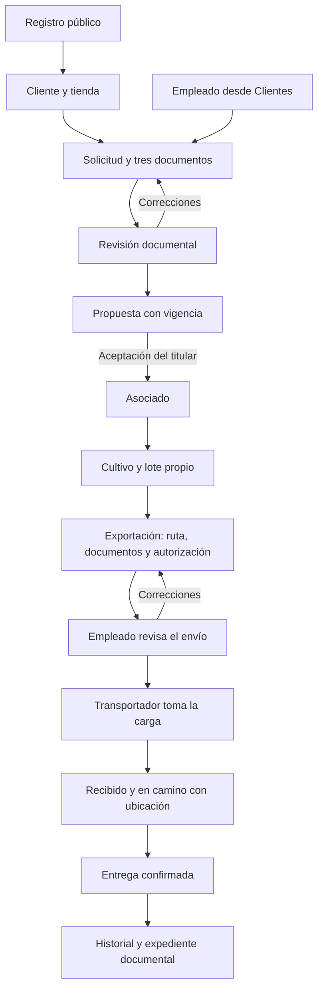

# Ritech — MVP de exportación de café

Aplicación modular para registrar clientes, formalizar su vinculación como asociados, gestionar cultivos y lotes de café, solicitar exportaciones, revisar documentos y coordinar el transporte mediante chat interno.

Los identificadores del código están en inglés. Los comentarios, mensajes y controles están en español. Se verifican Android y web; las otras carpetas de plataforma pertenecen a la estructura multiplataforma de Flutter.

## Tecnologías

| Tecnología | Versión del proyecto | Uso |
| --- | --- | --- |
| Flutter / Dart | Verificado con 3.47.9 / 3.13.7; Dart requerido `>=3.12.0 <4.0.0` | Interfaz adaptable y compilaciones Android/web. |
| Material 3 / `flutter_localizations` | Incluidos en el SDK | Tema y calendarios en español de Colombia. |
| `flutter_riverpod` | 3.4.3 | Estado, sesión, consultas e inyección de repositorios. |
| `go_router` | 18.0.2 resuelto | Rutas públicas y administración protegida. |
| `supabase_flutter` | 2.17.2 | Auth, PostgreSQL, Storage y funciones de servidor. |
| PostgreSQL y RLS | Alojados en Supabase | Reglas transaccionales, propiedad, permisos y exclusión de duplicados. |
| Edge Functions / TypeScript / Deno | SDK `@supabase/supabase-js` 2.108.2 | Operaciones administrativas con clave de servidor. |
| `flutter_dotenv` | 6.0.1 | Configuración pública local. |
| `file_picker` / `url_launcher` | 13.3.2 / 6.3.3 | Selección y apertura de documentos privados. |
| Flutter Test, `http`, Deno Test | Desarrollo | Pruebas de interfaz y servicios sin afectar personas reales. |
| Node.js / PGlite | PGlite 0.3.14 | PostgreSQL en memoria para pruebas de reglas y políticas. |
| Git / GitHub | `PATINO-0/Flutter-ll` | Historial y entrega del código. |

`pubspec.lock` conserva las versiones exactas. El CLI de Supabase se fija en `3.0.0`. Android requiere Java y SDK compatibles con Flutter. Python 3 solo verifica la documentación; no se utiliza al ejecutar Ritech.

## Roles

Predomina **Administrador > Trabajador > Transportador > Asociado > Cliente**. Los roles inferiores se conservan. Transportador es un perfil especializado, sin permisos generales de trabajador.

| Rol | Alcance |
| --- | --- |
| Cliente | Registro libre, tienda, solicitud de convenio, aceptación de su propuesta y atención propia. |
| Asociado | Tienda; su convenio, cultivos, lotes, exportaciones, documentos, seguimiento, entregas y chats. Cultivos y solicitudes de exportación requieren convenio activo. |
| Trabajador / empleado | Clientes, preparación/revisión/revocación de convenios, revisión de exportaciones, atención y coordinación de transporte. En Café consulta inventario y titulares; no crea, edita ni elimina. |
| Transportador | Cargas disponibles, toma de asignaciones compatibles, estados, ubicación y entrega de sus envíos, y chat. No consulta documentos ni importes privados. |
| Administrador | Todos los módulos, corrección de cultivos, catálogo, usuarios y roles. Conserva la protección del último administrador y la exclusión de convenios duplicados. El consentimiento y la autorización de un cargo corresponden al titular. |

La interfaz refleja decisiones que también se comprueban en funciones, PostgreSQL y Storage. Los metadatos de registro no conceden permisos.

## Flujos del MVP



### Registro y administración

El registro recibe nombre, correo, contraseña y confirmación. Auth crea perfil y rol `client` en una transacción. Si requiere confirmar correo, la aplicación lo informa; si obtiene sesión, abre el dashboard.

El administrador crea cuentas y modifica nombre, correo y roles mediante `create-user` y `manage-user`. **Eliminar acceso** desactiva perfil, retira roles y bloquea Auth conservando convenios, documentos, mensajes y envíos. No se puede retirar al último administrador activo. El administrador inicial autorizado es `usuarioprueba@gmail.com`, UUID `1bb00d6c-9b14-43d0-b096-88969fcd8376`; su preparación comprueba ambos valores.

### Convenios y aceptación

1. El cliente inicia desde la tienda. Trabajador o administrador también pueden preparar una propuesta desde **Clientes → Preparar convenio**.
2. Se requieren nombres, identificación, teléfono, dirección, actividad y tres soportes: identidad, carta de solicitud de convenio y certificado tributario, como RUT o equivalente.
3. Se exige tratamiento de datos. Si el empleado remite documentos, confirma disponer de autorización del cliente; no acepta el convenio en su nombre.
4. La solicitud del cliente pasa a revisión. El empleado puede devolver correcciones o preparar una propuesta. Al remitir un expediente completo desde Clientes se genera directamente la propuesta.
5. La vigencia inicial es de un año, editable por el personal antes del envío, con límite de diez años. El cliente recibe un aviso en chat y revisa el expediente.
6. **Aceptar mi convenio** exige confirmación expresa del titular. Se guardan cuenta, fecha y versión de aceptación y se añade `associate`. La revisión documental no asigna asociación por sí sola.
7. El cliente puede rechazar con motivo. El personal puede **Revocar convenio con motivo** desde Clientes o el expediente. El cierre se notifica por chat y conserva documentos e historial. Cuando no queda un convenio activo, se retira únicamente asociación y se conservan los roles laborales y administrativos.

Solo puede existir **un convenio activo o pendiente de aceptación por titular**, validado en apertura, envío y revisión y mediante índice único. También se impiden solicitudes y borradores simultáneos. El plazo ordinario es treinta días; rechazo y finalización del convenio anterior permiten otra vinculación inmediatamente.

La vigencia se decide con hora del servidor. El estado persistido, el aviso y los roles se sincronizan al consultar el perfil del titular o iniciar otra operación de vinculación. Un convenio vencido no permite una nueva exportación aunque el dispositivo todavía no haya actualizado su menú.

Los convenios anteriores conservan su vigencia sin inventar una aceptación ni una fecha. Si había duplicados, solo el más reciente permanece activo; los otros se cierran con motivo de regularización y se conserva su expediente. Revocar no cancela transportes aceptados ni elimina la cuenta.

### Café

El asociado con convenio activo registra cultivo, finca, ubicación, variedad y área. Cada lote conserva titular, cultivo, código, peso, cosecha y observaciones. Solo ve los propios; el personal consulta todos con nombre y correo del titular.

El trabajador supervisa sin acciones de escritura, restricción también aplicada por SQL. Administración conserva corrección y asignación. Los lotes antiguos sin propietario se asignan explícitamente. Un lote reservado por borrador, revisión o aprobación no puede modificarse. Un expediente histórico impide eliminarlo; una aprobación reserva ese lote definitivamente para una sola exportación.

### Tienda, rutas y cargos

Administración mantiene origen, destino, precio, moneda, unidad, condiciones y estado de cada servicio. Para exportación de café se requiere unidad `kg`, **Habilitar para exportación de café** y tarifa activa. Los servicios por volumen o de importación no se convierten automáticamente en exportaciones.

El asociado elige un origen del catálogo, un destino conectado y una tarifa. Completa direcciones concretas y destinatario. El servidor calcula `peso × precio/kg` a dos decimales y rechaza rutas retiradas o cotizaciones cambiadas. Cambiar la selección elimina la autorización económica previa.

Las tarifas iniciales son ejemplos que deben sustituirse por precios comerciales verificados. La antigua tarifa global queda como historial; las solicitudes actuales usan la tarifa de su ruta.

### Exportaciones

Las solicitudes nacen únicamente en **Exportaciones**, desde un lote propio elegible. Requieren factura comercial, lista de empaque y ficha de calidad y trazabilidad; son los soportes propuestos para este MVP y deben validarse según la operación comercial definitiva.

El titular autoriza importe y tratamiento de datos. El empleado recibe el aviso en **Chat de Envíos** y acepta o rechaza con motivo. El rechazo permite corregir el mismo lote recuperando datos y soportes. La aprobación crea envío, evento inicial y cargo `authorized` en una transacción y conserva datos del lote, ruta, condiciones, tarifa y documentos. Cambiar el catálogo no altera lo autorizado.

**Ritech registra el cargo y su autorización; no ejecuta débitos bancarios ni muestra un pago procesado por una pasarela.** El empleado no autoriza importes en nombre del cliente.

### Transporte y entrega

El empleado contacta al transportador y solicita por chat recoger una carga aceptada. El transportador decide tomarla. Una carga se asigna una sola vez. Cada conductor mantiene una ruta activa y solo añade lotes con iguales direcciones completas de recogida y destino, ignorando mayúsculas y espacios repetidos, antes de salir.

El flujo es **Aceptado → Recibido → En camino → Terminado / Entregado**. Cada cambio exige anotación; En camino requiere ubicación y admite reportes sucesivos. Finalizar exige confirmar entrega. Actualizan el conductor asignado o administración; el empleado coordina y revisa.

El cliente recibe el aviso de entrega. **Seguimiento** contiene únicamente cargas activas; **Mis envíos**, entregas y destino; **Exportaciones aceptadas**, el archivo documental completo.

### Chat y estabilidad

Atención, exportaciones y transporte tienen canales separados y contadores por participante. El conductor asignado recibe datos operativos, sin acceso a documentos ni importes. Los mensajes de sistema solo se crean desde funciones transaccionales.

Chat y cargas del conductor se consultan cada cinco segundos. El dashboard comprueba permisos y avisos cada quince. Exportaciones y seguimiento actualizan su lista visible; `currentUserAccessProvider` evita recargar módulos por recibir el mismo perfil. Se conservan tarjetas, formularios y selectores y se espera una consulta pendiente antes de repetirla. Los cambios reales de acceso siguen retirando datos no autorizados.

El chat carga mensajes anteriores en bloques de cien. Este MVP utiliza avisos internos; no incorpora push en segundo plano, GPS automático ni conexión con transportadoras externas.

## Arquitectura y módulos

```text
lib/main.dart                  Entorno, inicialización y arranque
lib/app.dart                   Tema, idioma y router
lib/core/                      Configuración, rutas, errores y validadores
lib/shared/widgets/            Marca y componentes comunes
lib/features/auth/             Registro, sesión, perfil y permisos efectivos
lib/features/administration/    Usuarios y roles
lib/features/dashboard/        Navegación por rol y actualización estable
lib/features/commerce/         Catálogo, clientes, convenios y chat
lib/features/exports/          Cultivos, lotes, exportaciones y transporte
supabase/migrations/           Esquema y reglas SQL versionadas
supabase/functions/            Servicios administrativos TypeScript
supabase/tests/                Reglas PostgreSQL ejecutadas con PGlite
test/                         Pruebas Flutter y repositorios simulados
docs/                         Guías de operación y despliegue
tool/                         Comprobación del catálogo documental
```

Cada módulo sigue **presentación → contrato de dominio → repositorio de datos → servicio protegido**. La interfaz ayuda a validar; PostgreSQL decide la operación. Riverpod permite sustituir servicios en pruebas. La clave administrativa permanece en Edge Functions.

| Proveedor o función compartida | Responsabilidad |
| --- | --- |
| `authSessionProvider`, `currentUserProfileProvider` | Identidad, roles actuales y sincronización de vencimientos. |
| `currentUserAccessProvider` | Detecta cambios reales de cuenta, estado activo y rol efectivo. |
| `authControllerProvider` | Estado de registro, acceso y cierre. |
| `adminUsersProvider` | Lista paginada con comprobación de administración. |
| `freightRatesProvider`, `customerAccountsProvider`, `associationRequestsProvider`, `agreementsProvider` | Datos comerciales por identidad y acceso. |
| `conversationsProvider` | Bandejas y mensajes sin leer por canal. |
| `coffeeCultivationsProvider`, `coffeeExportLotsProvider`, `coffeeExportRequestsProvider` | Inventario y expedientes autorizados. |
| `coffeeShipmentsProvider`, `transportJobsProvider`, `transportersProvider` | Seguimiento y coordinación de cargas. |
| `showAgreementAction`, `chooseAgreementExpiration`, `refreshAgreementViews` | Consentimiento, motivo, vigencia y actualización del convenio. |
| `showDeliveryUpdate` | Estado, ubicación y confirmación de entrega. |
| `showCommerceDialog`, `showCommerceError` | Ciclo de vida seguro y errores recuperables. |

## Responsabilidad de cada clase

El inventario incluye todas las clases y enumeraciones de producción, también los estados privados de widgets. Sus comentarios explican las responsabilidades junto al código.

| Clase o enumeración | Archivo | Responsabilidad |
| --- | --- | --- |
| `RiexportApp` | [lib/app.dart](lib/app.dart) | Configura la aplicación Material, su idioma, tema y navegación autenticada. |
| `AppConfig` | [lib/core/config/app_config.dart](lib/core/config/app_config.dart) | Carga y valida la URL y la clave pública de Supabase desde el entorno local. |
| `AuthRouterRefreshNotifier` | [lib/core/config/app_router.dart](lib/core/config/app_router.dart) | Notifica al enrutador los cambios de autenticación y libera su suscripción al cerrar. |
| `AppRoutes` | [lib/core/constants/app_routes.dart](lib/core/constants/app_routes.dart) | Centraliza las rutas públicas y protegidas para evitar direcciones duplicadas. |
| `AppException` | [lib/core/errors/app_exception.dart](lib/core/errors/app_exception.dart) | Transporta un mensaje de error comprensible sin publicar detalles internos del servidor. |
| `SupabaseService` | [lib/core/services/supabase_service.dart](lib/core/services/supabase_service.dart) | Inicializa una sola instancia del cliente público de Supabase antes de abrir la interfaz. |
| `AppTheme` | [lib/core/theme/app_theme.dart](lib/core/theme/app_theme.dart) | Define colores, tipografía y componentes Material utilizados en toda la aplicación. |
| `Validators` | [lib/core/utils/validators.dart](lib/core/utils/validators.dart) | Valida correo, nombres y contraseñas antes de enviar formularios al servidor. |
| `SupabaseUserManagementRepository` | [lib/features/administration/data/repositories/supabase_user_management_repository.dart](lib/features/administration/data/repositories/supabase_user_management_repository.dart) | Invoca servicios administrativos protegidos y traduce permisos, configuración y fallos de red. |
| `UserManagementRepository` | [lib/features/administration/domain/repositories/user_management_repository.dart](lib/features/administration/domain/repositories/user_management_repository.dart) | Define creación, edición, roles, listado y retirada del acceso administrativo. |
| `AdministrationPage` | [lib/features/administration/presentation/pages/administration_page.dart](lib/features/administration/presentation/pages/administration_page.dart) | Presenta el listado paginado de usuarios exclusivamente al administrador. |
| `_AdministrationPageState` | [lib/features/administration/presentation/pages/administration_page.dart](lib/features/administration/presentation/pages/administration_page.dart) | Conserva la paginación y coordina la edición y retirada de acceso de las cuentas. |
| `RoleSelector` | [lib/features/administration/presentation/widgets/role_selector.dart](lib/features/administration/presentation/widgets/role_selector.dart) | Permite asignar y retirar roles mostrando la responsabilidad de cada opción. |
| `UserEditorDialog` | [lib/features/administration/presentation/widgets/user_editor_dialog.dart](lib/features/administration/presentation/widgets/user_editor_dialog.dart) | Recoge nombre, correo, contraseña inicial y roles según se cree o edite una cuenta. |
| `_UserEditorDialogState` | [lib/features/administration/presentation/widgets/user_editor_dialog.dart](lib/features/administration/presentation/widgets/user_editor_dialog.dart) | Valida la cuenta editada y conserva el formulario cuando el servidor rechaza el cambio. |
| `AuthRemoteDataSource` | [lib/features/auth/data/datasources/auth_remote_data_source.dart](lib/features/auth/data/datasources/auth_remote_data_source.dart) | Encapsula el registro, acceso, cierre y lectura de sesión mediante Supabase Auth. |
| `SupabaseAuthRepository` | [lib/features/auth/data/repositories/supabase_auth_repository.dart](lib/features/auth/data/repositories/supabase_auth_repository.dart) | Traduce los resultados de Auth a contratos de dominio y errores de usuario en español. |
| `SupabaseProfileRepository` | [lib/features/auth/data/repositories/supabase_profile_repository.dart](lib/features/auth/data/repositories/supabase_profile_repository.dart) | Sincroniza vencimientos y carga perfil y roles con espera limitada y compatibilidad de despliegue. |
| `AuthSessionEvent` | [lib/features/auth/domain/entities/auth_session_event.dart](lib/features/auth/domain/entities/auth_session_event.dart) | Representa la existencia de sesión y la identidad que debe observar la navegación. |
| `UserProfile` | [lib/features/auth/domain/entities/user_profile.dart](lib/features/auth/domain/entities/user_profile.dart) | Representa la identidad, estado activo y rol efectivo de la cuenta autenticada. |
| `UserRole` | [lib/features/auth/domain/entities/user_role.dart](lib/features/auth/domain/entities/user_role.dart) | Enumera los cinco roles y el orden de acceso predominante utilizado por el menú. |
| `AuthRepository` | [lib/features/auth/domain/repositories/auth_repository.dart](lib/features/auth/domain/repositories/auth_repository.dart) | Define el contrato de autenticación que comparten producción y las pruebas sin red. |
| `ProfileRepository` | [lib/features/auth/domain/repositories/profile_repository.dart](lib/features/auth/domain/repositories/profile_repository.dart) | Define la consulta de un perfil con sus permisos actuales. |
| `LoginPage` | [lib/features/auth/presentation/pages/login_page.dart](lib/features/auth/presentation/pages/login_page.dart) | Presenta el formulario público para ingresar con correo y contraseña. |
| `_LoginPageState` | [lib/features/auth/presentation/pages/login_page.dart](lib/features/auth/presentation/pages/login_page.dart) | Valida credenciales, conserva controladores y presenta los errores del inicio de sesión. |
| `RegisterPage` | [lib/features/auth/presentation/pages/register_page.dart](lib/features/auth/presentation/pages/register_page.dart) | Presenta el registro público sin permitir que el solicitante elija permisos elevados. |
| `_RegisterPageState` | [lib/features/auth/presentation/pages/register_page.dart](lib/features/auth/presentation/pages/register_page.dart) | Valida el registro, confirma la contraseña y distingue acceso inmediato de confirmación de correo. |
| `AuthController` | [lib/features/auth/presentation/providers/auth_providers.dart](lib/features/auth/presentation/providers/auth_providers.dart) | Coordina las acciones de autenticación y el estado de carga sin duplicar solicitudes. |
| `AccountFormFields` | [lib/features/auth/presentation/widgets/account_form_fields.dart](lib/features/auth/presentation/widgets/account_form_fields.dart) | Reutiliza los campos de identidad y contraseña con las mismas validaciones. |
| `_AccountFormFieldsState` | [lib/features/auth/presentation/widgets/account_form_fields.dart](lib/features/auth/presentation/widgets/account_form_fields.dart) | Mantiene la visibilidad de las contraseñas de los formularios de cuenta. |
| `SupabaseCommerceRepository` | [lib/features/commerce/data/repositories/supabase_commerce_repository.dart](lib/features/commerce/data/repositories/supabase_commerce_repository.dart) | Consulta el catálogo y delega convenios, consentimientos y chat en PostgreSQL y Storage protegidos. |
| `FreightRate` | [lib/features/commerce/domain/entities/commerce_models.dart](lib/features/commerce/domain/entities/commerce_models.dart) | Representa un servicio, su ruta, precio, unidad y habilitación para exportar café. |
| `AgreementDocumentKind` | [lib/features/commerce/domain/entities/commerce_models.dart](lib/features/commerce/domain/entities/commerce_models.dart) | Enumera identidad, carta de convenio y certificado tributario exigidos al vincularse. |
| `RequestDocument` | [lib/features/commerce/domain/entities/commerce_models.dart](lib/features/commerce/domain/entities/commerce_models.dart) | Conserva el tipo, nombre y ruta privada de un soporte de vinculación. |
| `AssociationRequest` | [lib/features/commerce/domain/entities/commerce_models.dart](lib/features/commerce/domain/entities/commerce_models.dart) | Representa datos, documentos, revisión y estado del convenio vinculado a una solicitud. |
| `Agreement` | [lib/features/commerce/domain/entities/commerce_models.dart](lib/features/commerce/domain/entities/commerce_models.dart) | Conserva el expediente, vigencia, aceptación y cierre del convenio comercial. |
| `SupportConversation` | [lib/features/commerce/domain/entities/commerce_models.dart](lib/features/commerce/domain/entities/commerce_models.dart) | Identifica una conversación autorizada y sus mensajes pendientes por canal. |
| `SupportMessage` | [lib/features/commerce/domain/entities/commerce_models.dart](lib/features/commerce/domain/entities/commerce_models.dart) | Representa texto humano o un aviso de sistema con su expediente relacionado. |
| `CommerceRepository` | [lib/features/commerce/domain/repositories/commerce_repository.dart](lib/features/commerce/domain/repositories/commerce_repository.dart) | Define el catálogo, convenios, decisiones del titular y atención del flujo comercial. |
| `AssociationDetailPage` | [lib/features/commerce/presentation/pages/association_detail_page.dart](lib/features/commerce/presentation/pages/association_detail_page.dart) | Presenta documentos, revisión, aceptación del titular y cierre del convenio. |
| `_AssociationDetailPageState` | [lib/features/commerce/presentation/pages/association_detail_page.dart](lib/features/commerce/presentation/pages/association_detail_page.dart) | Coordina revisión y vigencia sin permitir decisiones simultáneas sobre el expediente. |
| `AssociationFormPage` | [lib/features/commerce/presentation/pages/association_form_page.dart](lib/features/commerce/presentation/pages/association_form_page.dart) | Recoge datos y soportes de una solicitud propia o de una propuesta preparada por el personal. |
| `_AssociationFormPageState` | [lib/features/commerce/presentation/pages/association_form_page.dart](lib/features/commerce/presentation/pages/association_form_page.dart) | Conserva borrador, archivos, consentimiento y vigencia antes de remitir el expediente. |
| `AssociationRequestsPage` | [lib/features/commerce/presentation/pages/commerce_lists.dart](lib/features/commerce/presentation/pages/commerce_lists.dart) | Muestra solicitudes propias al cliente y la bandeja documental al personal. |
| `AgreementsPage` | [lib/features/commerce/presentation/pages/commerce_lists.dart](lib/features/commerce/presentation/pages/commerce_lists.dart) | Conserva propuestas y convenios históricos con su estado, vigencia y documentos. |
| `SupportInboxPage` | [lib/features/commerce/presentation/pages/commerce_lists.dart](lib/features/commerce/presentation/pages/commerce_lists.dart) | Separa las bandejas de atención, exportaciones y coordinación de transporte. |
| `_SupportInboxPageState` | [lib/features/commerce/presentation/pages/commerce_lists.dart](lib/features/commerce/presentation/pages/commerce_lists.dart) | Sondea conversaciones sin duplicar consultas y abre exclusivamente los chats permitidos. |
| `CustomerAccountsPage` | [lib/features/commerce/presentation/pages/customer_accounts_page.dart](lib/features/commerce/presentation/pages/customer_accounts_page.dart) | Permite al personal preparar una vinculación o revocar con motivo el convenio abierto de un cliente. |
| `StorePage` | [lib/features/commerce/presentation/pages/store_page.dart](lib/features/commerce/presentation/pages/store_page.dart) | Presenta tarifas y destinos y permite al administrador mantener el catálogo habilitado. |
| `SupportChatPage` | [lib/features/commerce/presentation/pages/support_chat_page.dart](lib/features/commerce/presentation/pages/support_chat_page.dart) | Presenta mensajes y enlaces a expedientes dentro de una conversación autorizada. |
| `_SupportChatPageState` | [lib/features/commerce/presentation/pages/support_chat_page.dart](lib/features/commerce/presentation/pages/support_chat_page.dart) | Conserva el mensaje escrito, amplía el historial y confirma lecturas sin recrear la página. |
| `CommerceAsyncPanel` | [lib/features/commerce/presentation/widgets/commerce_widgets.dart](lib/features/commerce/presentation/widgets/commerce_widgets.dart) | Mantiene coherentes los estados de carga, datos y recuperación de las consultas comerciales. |
| `CommerceSection` | [lib/features/commerce/presentation/widgets/commerce_widgets.dart](lib/features/commerce/presentation/widgets/commerce_widgets.dart) | Organiza títulos, acciones y contenido con un ancho adaptable para móvil y escritorio. |
| `DashboardPage` | [lib/features/dashboard/presentation/pages/dashboard_page.dart](lib/features/dashboard/presentation/pages/dashboard_page.dart) | Presenta únicamente los módulos autorizados para el rol efectivo de la sesión. |
| `_DashboardPageState` | [lib/features/dashboard/presentation/pages/dashboard_page.dart](lib/features/dashboard/presentation/pages/dashboard_page.dart) | Conserva la sección elegida y comprueba permisos y avisos sin reiniciar las pantallas abiertas. |
| `_DashboardSection` | [lib/features/dashboard/presentation/pages/dashboard_page.dart](lib/features/dashboard/presentation/pages/dashboard_page.dart) | Describe el título, icono y contador de una opción autorizada del panel. |
| `DashboardHome` | [lib/features/dashboard/presentation/widgets/dashboard_home.dart](lib/features/dashboard/presentation/widgets/dashboard_home.dart) | Presenta lotes de café, clientes/asociados para el personal, solicitudes, exportaciones aceptadas y estados autorizados; permite actualizar los indicadores. |
| `_DashboardMetric` | [lib/features/dashboard/presentation/widgets/dashboard_home.dart](lib/features/dashboard/presentation/widgets/dashboard_home.dart) | Presenta un conteo con estados de carga y error, sin confundir un fallo con cero registros. |
| `_DashboardStates` | [lib/features/dashboard/presentation/widgets/dashboard_home.dart](lib/features/dashboard/presentation/widgets/dashboard_home.dart) | Agrupa solicitudes y transporte por sus estados y conserva estados nuevos sin omitir registros. |
| `SupabaseCoffeeExportsRepository` | [lib/features/exports/data/supabase_coffee_exports_repository.dart](lib/features/exports/data/supabase_coffee_exports_repository.dart) | Invoca los servicios protegidos de cultivos, lotes, tarifas, exportaciones y transportadores. |
| `CoffeeExportsRepository` | [lib/features/exports/domain/coffee_exports_repository.dart](lib/features/exports/domain/coffee_exports_repository.dart) | Define inventario, cotización, documentos, revisión, transporte y entrega de café. |
| `CoffeeCultivation` | [lib/features/exports/domain/export_models.dart](lib/features/exports/domain/export_models.dart) | Representa un cultivo, su ubicación, variedad, área e identidad del titular. |
| `CoffeeExportLot` | [lib/features/exports/domain/export_models.dart](lib/features/exports/domain/export_models.dart) | Representa un lote cosechado y la reserva que impide exportarlo más de una vez. |
| `ExportDocumentKind` | [lib/features/exports/domain/export_models.dart](lib/features/exports/domain/export_models.dart) | Enumera factura comercial, lista de empaque y ficha de calidad requeridas para exportar. |
| `ExportDocument` | [lib/features/exports/domain/export_models.dart](lib/features/exports/domain/export_models.dart) | Conserva la referencia privada de un soporte del expediente de exportación. |
| `CoffeeExportRequest` | [lib/features/exports/domain/export_models.dart](lib/features/exports/domain/export_models.dart) | Conserva solicitud, instantánea del lote, tarifa autorizada, documentos y revisión. |
| `ExportQuote` | [lib/features/exports/domain/export_models.dart](lib/features/exports/domain/export_models.dart) | Representa el costo por peso y la ruta habilitada que el servidor cotizó al titular. |
| `CoffeeShipment` | [lib/features/exports/domain/export_models.dart](lib/features/exports/domain/export_models.dart) | Representa una carga aprobada, su transportador, ubicación, eventos y entrega. |
| `CoffeeCropsPage` | [lib/features/exports/presentation/coffee_crops_page.dart](lib/features/exports/presentation/coffee_crops_page.dart) | Permite al asociado gestionar sus cultivos y al trabajador supervisar el inventario con sus titulares. |
| `CoffeeExportsPage` | [lib/features/exports/presentation/export_pages.dart](lib/features/exports/presentation/export_pages.dart) | Separa solicitudes en revisión del archivo de exportaciones aceptadas. |
| `_CoffeeExportsPageState` | [lib/features/exports/presentation/export_pages.dart](lib/features/exports/presentation/export_pages.dart) | Conserva el filtro de archivo y actualiza solicitudes visibles sin cerrar formularios. |
| `CoffeeExportDetailPage` | [lib/features/exports/presentation/export_pages.dart](lib/features/exports/presentation/export_pages.dart) | Presenta el lote, documentos y costo archivados y la decisión del empleado. |
| `_CoffeeExportDetailPageState` | [lib/features/exports/presentation/export_pages.dart](lib/features/exports/presentation/export_pages.dart) | Gestiona aceptación o rechazo de una exportación con motivo y actualización de sus módulos. |
| `CoffeeShipmentHistoryPage` | [lib/features/exports/presentation/export_pages.dart](lib/features/exports/presentation/export_pages.dart) | Separa seguimiento de cargas activas e historial de entregas realizadas. |
| `_CoffeeShipmentHistoryPageState` | [lib/features/exports/presentation/export_pages.dart](lib/features/exports/presentation/export_pages.dart) | Actualiza estados manteniendo la expansión del envío correcto cuando llegan otros registros. |
| `ExportRequestFormPage` | [lib/features/exports/presentation/export_request_form_page.dart](lib/features/exports/presentation/export_request_form_page.dart) | Solicita una exportación desde un lote propio y una tarifa habilitada. |
| `_ExportRequestFormPageState` | [lib/features/exports/presentation/export_request_form_page.dart](lib/features/exports/presentation/export_request_form_page.dart) | Conserva ruta, direcciones, soportes y consentimiento y exige autorizar cada cotización nueva. |
| `TransportJobsPage` | [lib/features/exports/presentation/transport_pages.dart](lib/features/exports/presentation/transport_pages.dart) | Presenta cargas disponibles, asignaciones compatibles y entregas del transportador. |
| `_TransportJobsPageState` | [lib/features/exports/presentation/transport_pages.dart](lib/features/exports/presentation/transport_pages.dart) | Sondea cargas sin superponer consultas y coordina toma, estados y chat del envío. |
| `TransporterDirectoryPage` | [lib/features/exports/presentation/transport_pages.dart](lib/features/exports/presentation/transport_pages.dart) | Permite al personal contactar transportadores y solicitar la recogida de cargas aceptadas. |
| `_TransporterDirectoryPageState` | [lib/features/exports/presentation/transport_pages.dart](lib/features/exports/presentation/transport_pages.dart) | Gestiona chats de coordinación y la creación administrativa de las cinco cuentas de prueba. |
| `AppBrand` | [lib/shared/widgets/app_brand.dart](lib/shared/widgets/app_brand.dart) | Presenta la identidad visual de Ritech en sus variantes completa y compacta. |
| `ComingSoonPanel` | [lib/shared/widgets/coming_soon_panel.dart](lib/shared/widgets/coming_soon_panel.dart) | Conserva un componente de aviso reutilizable para módulos futuros, fuera de los flujos activos del MVP. |

## Datos y seguridad

| Tablas | Responsabilidad |
| --- | --- |
| `profiles`, `user_roles` | Identidad, estado y roles. |
| `freight_rates` | Catálogo de rutas y precios. |
| `association_requests`, `request_documents`, `agreements` | Documentos, propuesta, aceptación, vigencia y cierre. |
| `conversations`, `chat_messages`, `conversation_reads` | Canales, avisos y lecturas por participante. |
| `coffee_cultivations`, `coffee_lots` | Propiedad, cultivo, cosecha e inventario. |
| `export_requests`, `export_documents`, `export_charges` | Datos y tarifa autorizados y cargo interno. |
| `shipments`, `shipment_events` | Asignación, ubicación, estados y entrega. |
| `coffee_export_pricing` | Tarifa global histórica, sin uso en nuevas cotizaciones. |

RLS, permisos RPC, bloqueos y restricciones únicas protegen propiedad, decisiones y concurrencia. Se conserva la protección del último administrador.

`agreement-documents` y `export-documents` son privados. Admiten PDF/JPG/PNG hasta 10 MiB, con cabeceras comprobadas en Flutter y validación de existencia, MIME y tamaño en el servidor. Los soportes enviados no se sobrescriben ni eliminan desde el cliente; los enlaces duran un minuto. Un documento descargado o un enlace ya emitido no se recupera al revocar; se impiden nuevos accesos. Los objetos sustituidos de borradores requieren limpieza administrativa posterior.

| Servicio / RPC | Función |
| --- | --- |
| `create-user`, `manage-user`, `seed-transporters` | Cuentas y roles administrativos con validación de token e identidad. |
| `start_association_request`, `submit_association_request`, `review_association_request` | Exclusión, soportes, plazo y propuesta con vigencia. |
| `respond_to_agreement`, `revoke_agreement`, `refresh_my_agreement_status` | Aceptación del titular, cierre con motivo y vencimiento. |
| `list_coffee_cultivations`, `list_coffee_lots` | Supervisión con identidad del titular autorizado. |
| `save_coffee_cultivation`, `save_coffee_export_lot`, `delete_coffee_export_lot` | Escritura exclusiva del asociado titular con convenio activo o administración. |
| `start_coffee_export`, `quote_coffee_export`, `submit_coffee_export`, `review_coffee_export` | Reserva única, costo, consentimiento y revisión de envío. |
| `take_coffee_shipment`, `update_coffee_delivery` | Compatibilidad, exclusividad y entrega confirmada. |
| `open_support_conversation`, `open_export_conversation`, `open_transport_conversation`, `request_transport_pickup` | Canales y coordinación. |
| `set_user_roles`, `admin_update_user`, `admin_deactivate_user` | Edición segura y retirada de acceso. |

Las funciones usan `verify_jwt = false` en el gateway por compatibilidad y validan explícitamente `auth.getUser` y administración. Esto no concede operaciones administrativas anónimas. Las claves privilegiadas pertenecen exclusivamente al entorno del servidor.

## Instalación

```powershell
Copy-Item .env.example .env
# Configura SUPABASE_URL y SUPABASE_PUBLISHABLE_KEY en el archivo local.
flutter pub get
flutter run -d chrome
```

Para Android inicia un emulador o conecta un dispositivo y ejecuta `flutter run`. `.env` se excluye de Git. La clave publicable identifica al cliente; Auth y RLS aplican su seguridad. Nunca incluyas `SUPABASE_SERVICE_ROLE_KEY` en Flutter o assets.

```powershell
npx supabase@3.0.0 login
npx supabase@3.0.0 link --project-ref mdlcewexhzskapxiklsm
npx supabase@3.0.0 migration list --remote
npx supabase@3.0.0 db push --remote --dry-run
npx supabase@3.0.0 db push --remote --yes
npx supabase@3.0.0 functions deploy create-user manage-user seed-transporters --use-api --yes
```

Las nueve migraciones se aplican en orden y el CLI omite las registradas. Si el esquema se instaló manualmente, verifica su correspondencia y sincroniza solo las versiones realmente aplicadas. Las últimas son `20261109000000_agreement_lifecycle.sql` y `20261109010000_coffee_supervision.sql`.

Desplegar solo `seed-transporters` no instala edición. Un `OPTIONS` a `manage-user` con `404 Requested function was not found` indica una función ausente. La petición previa debe responder correctamente; un `POST` sin sesión debe conservar `401`.

Administración crea las cinco cuentas de prueba desde **Transportadores → Crear cinco transportadores de prueba**: `transportador@gmail.com` y `transportador1@gmail.com` hasta `transportador4@gmail.com`, contraseña inicial `12345678`. Repetir omite transportadores existentes sin cambiar sus contraseñas y reporta conflictos con otras cuentas.

## Verificación y artefactos

El alcance de esta entrega es exclusivamente café con Flutter y Supabase. El [guion de demostración](docs/demo_guide.md) explica las cuentas DEMO, el ensayo por roles y el recorrido de respaldo. Las contraseñas y el estado privado del ensayo se conservan en `.demo/`, excluido de Git; la [evidencia del backend](docs/demo_backend_evidence.json) contiene únicamente pasos e identificadores.

La [verificación de entrega del 9 de noviembre](docs/verification_20261109.md) registra las 125 pruebas aprobadas, la comprobación del backend y los límites de la validación.

```powershell
flutter analyze --no-pub
flutter test --no-pub
npm ci --prefix supabase/tests
npm test --prefix supabase/tests
npm exec --yes --package=deno -- deno test --allow-env supabase/functions
python tool/verify_documentation.py
flutter build apk --debug --no-pub
flutter build apk --release --no-pub
flutter build web --no-pub
```

Flutter comprueba formularios, roles, estabilidad de sondeos, consentimiento, rutas y supervisión. PGlite ejecuta reglas de PostgreSQL con Auth y Storage simulados; la suite final instala el esquema completo. Deno verifica autorización, compensación y CORS. Las pruebas no crean cuentas reales. Correo, archivos nativos y concurrencia con varias conexiones requieren validación contra el proyecto alojado.

Los artefactos están en `build/app/outputs/flutter-apk/app-debug.apk`, `build/app/outputs/flutter-apk/app-release.apk` y `build/web/`. `build/` se excluye de Git; el repositorio conserva el código necesario para reproducirlos. El APK release conserva la firma de desarrollo configurada en el proyecto y sirve para instalación directa en la demostración; publicar en una tienda requiere configurar la firma de distribución.

## Guías y mantenimiento

- [Registro, roles y diagnóstico administrativo](docs/registration_and_roles.md).
- [Convenios y atención](docs/association_workflow.md).
- [Exportaciones y transporte](docs/coffee_exports_and_transport.md).

Al cambiar reglas, actualiza SQL, interfaz, pruebas y documentación. `tool/verify_documentation.py` comprueba comentarios de clases y su presencia en este catálogo. Los archivos generados por plataformas y compilaciones se administran con sus herramientas correspondientes.

Integrantes: Vanessa Bastidas, Samuel Patiño, Juan Vizuette y Anderson Ojeda.
